  

  Academic at Eskişehir Osmangazi University, researching AI, large language models and immersive learning. 
  I also build web applications at <a href="https://github.com/Kodrika">@Kodrika</a> and write open source packages for the PHP ecosystem.

  

  

  <picture>
    <source media="(prefers-color-scheme: dark)" srcset="https://raw.githubusercontent.com/TahsinGokalp/TahsinGokalp/output/elephant-dark.svg" />
    <source media="(prefers-color-scheme: light)" srcset="https://raw.githubusercontent.com/TahsinGokalp/TahsinGokalp/output/elephant-light.svg" />
    
  </picture>

